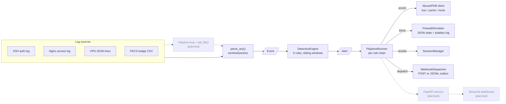

# SentinelSOAR

**An intrusion detection and automated response engine that correlates SSH, web, VPN and
physical badge telemetry, detects attacks mapped to MITRE ATT&CK, and contains them
through safety-guarded SOAR playbooks.**

**Status:** core detection + SOAR engine complete; API, dashboard, Docker cyber range and
benchmarks in progress.

[](#quickstart-what-works-today)
[](LICENSE)
[](#detection-coverage)

---

## What it does

SentinelSOAR turns raw log lines from four very different sources (OpenSSH `auth.log`,
Nginx access logs, VPN gateway JSON and physical access-control badge CSV) into a single
normalized `Event` stream. A detection engine runs six correlation rules over that stream:
brute force and password spraying, SQL injection, path traversal, a successful login right
after a brute force, and a physical-vs-digital identity check (someone "logs in from abroad"
while their badge says they are inside the building).

Every alert then goes through a **detect → enrich → contain** chain: the source IP is
scored against AbuseIPDB (or a deterministic offline mock), malicious IPs are blocked on a
simulated firewall that renders real `iptables` commands, compromised users' sessions are
revoked, critical incidents are escalated to an analyst, and a structured JSON alert is
sent to a webhook or written to an outbox file.

## Current status

| Component | Status | Where |
|---|---|---|
| Log parsers (SSH, Nginx, VPN, PACS) | ✅ Done | `sentinel/parsers/` |
| Detection engine (6 rules) | ✅ Done | `sentinel/detection/` |
| Threat intel (AbuseIPDB + mock) | ✅ Done | `sentinel/intel/abuseipdb.py` |
| SOAR playbooks, firewall, sessions, webhook | ✅ Done | `sentinel/soar/` |
| Pipeline (ingest → detect → respond loop) | 🕓 Planned (only the `tail_file()` log follower exists) | `sentinel/pipeline.py` |
| FastAPI service | 🕓 Planned | — |
| Streamlit SOC dashboard | 🕓 Planned | — |
| Attack / traffic simulator | 🕓 Planned | — |
| Docker cyber range | 🕓 Planned | — |
| GitHub Actions CI | 🕓 Planned | — |
| Automated benchmark | 🕓 Planned | — |

**Measured today (2026-10-27)** with the commands in [Quickstart](#quickstart-what-works-today).
These are codebase figures, not benchmark results:

| Metric | Value | Source |
|---|---|---|
| Detection rules | **6** | `len(DetectionEngine.RULES)` |
| SOAR playbooks | **5** | `len(PLAYBOOKS)` |
| Tests | **200** (all passing, no network) | `pytest --collect-only -q` |
| Line coverage of `sentinel/` | **94%** (1,416 statements) | `pytest --cov=sentinel -q` |

## Detection coverage

Rule IDs, titles and techniques come from `DetectionEngine.RULES`. Thresholds are the
defaults in `sentinel/config.py`; all are env-overridable (see the
[env var reference](#configuration-reference)).

| Rule | Title · MITRE | Logic | Severity | False-positive mitigation |
|---|---|---|---|---|
| **SENTINEL-001** | SSH Brute Force · [T1110.001](https://attack.mitre.org/techniques/T1110/001/) | More than 5 `ssh_failed` events from one source IP within a 60 s sliding window. | High at >5; Critical at ≥20 failures. | sshd logs one bad-username attempt twice ("Invalid user X" + "Failed password for invalid user X"); the pair is counted once if ≤1 s apart. One alert per IP per 300 s cooldown. The parser reads the IP from the end of the line, so a crafted username can't spoof it. |
| **SENTINEL-002** | Web/VPN Login Brute Force · [T1110.001](https://attack.mitre.org/techniques/T1110/001/), [T1110.003](https://attack.mitre.org/techniques/T1110/003/) | More than 5 failed logins from one IP within 60 s, counting `POST /login` or `/wp-login.php` answered 401/403 **and** failed VPN logins together. ≥3 distinct usernames re-labels it *Password Spraying* (T1110.003). | High at >5; Critical at ≥20. | Only failed login POSTs count (a `GET /login` 401 does not). Same per-IP cooldown. |
| **SENTINEL-003** | SQL Injection Attempt · [T1190](https://attack.mitre.org/techniques/T1190/) | Weighted signals (UNION SELECT, quoted/numeric tautologies, `SLEEP(`/`BENCHMARK(`, `information_schema`, stacked queries, comment terminators, hex payloads, …) scored on the URI after two rounds of URL decoding and inline-comment normalization. Fires at score ≥4. | Medium <7, High 7–9, Critical ≥10. | A single weak signal (a bare `select`, a `-- `, `sleep(`) cannot reach the threshold, so URLs like `/blog/select-from-the-menu` stay quiet. |
| **SENTINEL-004** | Path Traversal Attempt · [T1190](https://attack.mitre.org/techniques/T1190/) | `..` as a whole path segment after up to 3 decode rounds (catches `%2e%2e%2f` and double-encoded `%252e`), backslash→slash and repeated-slash normalization, overlong UTF-8 (`%c0%ae`), or sensitive targets (`/etc/passwd`, `/etc/shadow`, `boot.ini`, `win.ini`, …). | Critical when traversal hits a sensitive file; otherwise High. | `..` must be a full segment: `report..final.pdf` and `/a/.../b` do not match. |
| **SENTINEL-005** | Impossible Travel / Physical-Digital Anomaly · [T1078](https://attack.mitre.org/techniques/T1078/) | **(a)** Successful VPN login from an external IP while the user's latest granted badge swipe at the secure facility (`HQ`) is "in", within 8 h. **(b)** SSH login from an internal CIDR with no granted badge-in at the facility in the last 12 h. | Always Critical. | Only *granted* swipes at the secure facility count. (b) only checks users who have ever badged, so service accounts are skipped. VPN logins from internal IPs are ignored. A late-arriving badge-in re-checks recent VPN logins, using event time rather than arrival order. |
| **SENTINEL-006** | Successful Login After Brute Force · [T1078](https://attack.mitre.org/techniques/T1078/) | `ssh_success` from an IP that tripped SENTINEL-001 within the last 3600 s. | Always Critical. | Requires an actual threshold breach: 5 typos followed by a success does not fire. One alert per (IP, user) per cooldown. |

## SOAR playbooks and safety guards

Playbooks register themselves in the `PLAYBOOKS` registry with a `@playbook(name)`
decorator (`sentinel/soar/playbooks.py`). Each one returns an `ActionRecord`
(`name, status, detail, started_ns, finished_ns, data`).

| Playbook | Trigger | Action |
|---|---|---|
| `enrich_ip_reputation` | Every chain, when the alert has a source IP | Scores the IP with AbuseIPDB (live, cached, or mock) and attaches the result to the incident. |
| `block_ip_firewall` | Severity High/Critical **or** intel score ≥ 75 | Adds a TTL'd (default 1 h) DROP rule to the firewall. Reports `skipped_already_blocked` for an existing rule and `refused_safety_guard` for protected IPs. |
| `revoke_user_sessions` | SENTINEL-005/006 chains, T1078 alerts only | Revokes the user's active sessions plus any session from the source IP. A repeat alert reports `skipped_already_revoked`. |
| `escalate_critical` | Every chain | Sets priority by severity (Critical P1, High P2, Medium P3, Low P4). Critical incidents are tagged `escalated` + `needs-analyst`. |
| `dispatch_webhook_alert` | Every chain (runs last) | POSTs `{schema_version, alert, intel, actions_taken, timestamp}` to `WEBHOOK_URL` with retry, otherwise appends it to a JSONL outbox. |

Default chains (from `DEFAULT_PLAYBOOK_CHAINS` in `sentinel/config.py`, overridable with
`SENTINEL_PLAYBOOK_CHAINS`):

| Rules | Chain |
|---|---|
| SENTINEL-001 – 004 | enrich → block → escalate → dispatch |
| SENTINEL-005, 006 | enrich → block → revoke sessions → escalate → dispatch |
| any other rule | enrich → escalate → dispatch |

**Guardrails**

- **Simulated firewall by default.** Rules live in memory plus an atomically written JSON
  file, and each change renders an `iptables -I/-D INPUT -s <ip> -j DROP` string into a
  command log. Real `iptables`/`ip6tables` runs only with `SENTINEL_REAL_FIREWALL=1`, via
  `subprocess.run` with a list argv (never a shell).
- **Protected ranges are never blocked:** RFC 1918, CGNAT `100.64.0.0/10`, IPv6 ULA,
  loopback, link-local, multicast, unspecified, reserved, and the configured internal CIDRs.
- **Configurable allowlist** (`SENTINEL_FIREWALL_ALLOWLIST`, IPs or CIDRs).
- **Idempotent blocking.** Blocking an already-blocked IP returns the existing rule without
  a second rule or command. This holds under concurrency (lock-protected; tested with 16 threads).
- **Strict IP validation.** Anything that isn't a bare IP address, such as `"1.2.3.4; rm -rf /"`
  or leading whitespace, is refused before any command is rendered.
- **TTL expiry.** Expired rules are removed and render the matching `-D` command.
- **The AbuseIPDB API key is never logged.** It only travels in the request header. Logs
  record exception types only, and `repr()` of the client and settings hides it.
- **Failures never stop the chain.** A failing or unknown playbook is recorded as `error`
  and the chain continues. The webhook dispatcher never raises and only accepts `http(s)` URLs.

## Architecture



Solid boxes and arrows are implemented. Dashed ones are planned.

## Quickstart (what works today)

```bash
git clone https://github.com/yp012/sentinel.git
cd sentinel
python3 -m venv .venv && source .venv/bin/activate
pip install -r requirements-dev.txt

pytest                      # 200 tests, no network access needed
pytest --cov=sentinel -q    # coverage report
flake8                      # style (config in setup.cfg)
bandit -c bandit.yaml -r .  # security lint
```

Parse a few sample log lines and run them through the detection engine. Run this from
the repo root:

```bash
python - <<'EOF'
from sentinel.detection import DetectionEngine
from sentinel.parsers import parse_any

lines = [
    # Six failed SSH logins in 6 seconds, then a successful one from the same IP
    *[f"Oct 27 10:15:0{s} bastion sshd[2211]: Failed password for root "
      f"from 203.0.113.7 port 51022 ssh2" for s in range(6)],
    "Oct 27 10:15:30 bastion sshd[2211]: Accepted password for root "
    "from 203.0.113.7 port 51022 ssh2",
    # SQL injection and path traversal against the web tier (Nginx combined format)
    '198.51.100.9 - - [27/Oct/2026:10:16:00 +0000] "GET /item?id=1%27%20UNION%20SELECT'
    '%20password%20FROM%20users--%20 HTTP/1.1" 200 512 "-" "sqlmap/1.8"',
    '198.51.100.9 - - [27/Oct/2026:10:16:05 +0000] "GET /download?file=..%252f..%252f'
    '..%252fetc%252fpasswd HTTP/1.1" 404 0 "-" "curl/8.0"',
    # alice badges into HQ, then "logs in" over VPN from an external IP
    "2026-10-27T08:55:00Z,B-1001,alice,D-12,HQ,in,true",
    '{"ts": "2026-10-27T10:20:00Z", "user": "alice", "src_ip": "198.51.100.20", '
    '"event": "vpn_login", "success": true}',
]

engine = DetectionEngine()
for line in lines:
    event = parse_any(line)
    if event is None:
        continue
    for alert in engine.process(event):
        print(f"{alert.rule_id}  {alert.severity:<8}  {alert.mitre_technique:<9}  "
              f"{alert.title}  (src={alert.src_ip}, user={alert.user})")
EOF
```

Output:

```text
SENTINEL-001  High      T1110.001  SSH Brute Force  (src=203.0.113.7, user=root)
SENTINEL-006  Critical  T1078      Successful Login After Brute Force  (src=203.0.113.7, user=root)
SENTINEL-003  Critical  T1190      SQL Injection Attempt  (src=198.51.100.9, user=)
SENTINEL-004  Critical  T1190      Path Traversal Attempt  (src=198.51.100.9, user=)
SENTINEL-005  Critical  T1078      Impossible Travel / Physical-Digital Anomaly  (src=198.51.100.20, user=alice)
```

### Configuration reference

All settings live in `sentinel/config.py` and are read from the environment when
`sentinel.config` is first imported. Invalid numbers fail loudly at startup.

| Variable | Default | Purpose |
|---|---|---|
| `SENTINEL_WINDOW_MAX_EVENTS_PER_KEY` | `1000` | Max events kept per key in any sliding window |
| `SENTINEL_WINDOW_MAX_KEYS` | `100000` | Max keys (IPs/users) per detector; least recently used evicted |
| `SENTINEL_ALERT_COOLDOWN_S` | `300` | Min gap between repeat alerts for the same key |
| `SSH_BRUTEFORCE_THRESHOLD` | `5` | SENTINEL-001 fires above this many failures |
| `SSH_BRUTEFORCE_CRITICAL` | `20` | SENTINEL-001 Critical at this many failures |
| `SSH_BRUTEFORCE_WINDOW_S` | `60` | SENTINEL-001 sliding window |
| `SSH_INVALID_USER_DEDUPE_S` | `1.0` | Max gap for the invalid-user double-log pair |
| `HTTP_LOGIN_FAIL_THRESHOLD` | `5` | SENTINEL-002 fires above this many failures |
| `HTTP_LOGIN_FAIL_CRITICAL` | `20` | SENTINEL-002 Critical at this many failures |
| `HTTP_LOGIN_FAIL_WINDOW_S` | `60` | SENTINEL-002 sliding window |
| `WEB_SPRAY_DISTINCT_USERS` | `3` | Distinct usernames that make SENTINEL-002 a T1110.003 spray |
| `SQLI_SCORE_THRESHOLD` | `4` | SENTINEL-003 minimum score |
| `SENTINEL_ONSITE_WINDOW_S` | `28800` (8 h) | SENTINEL-005(a): how long a badge-in counts as "on site" |
| `SENTINEL_BADGE_LOOKBACK_S` | `43200` (12 h) | SENTINEL-005(b): badge-in lookback for on-prem SSH |
| `SENTINEL_SECURE_FACILITY` | `HQ` | Facility name for SENTINEL-005 (empty = any facility) |
| `SENTINEL_INTERNAL_CIDRS` | `10.0.0.0/8,172.16.0.0/12,192.168.0.0/16` | Internal ranges (SENTINEL-005, firewall guard) |
| `SENTINEL_REQUIRE_KNOWN_BADGE` | `true` | SENTINEL-005(b) only for users who have ever badged |
| `SUCCESS_AFTER_BF_WINDOW_S` | `3600` | SENTINEL-006: how long a brute-forcing IP stays suspicious |
| `ABUSEIPDB_API_KEY` | *(unset)* | Enables live AbuseIPDB lookups; unset = mock mode |
| `ABUSEIPDB_BLOCK_SCORE` | `75` | Intel score at which `block_ip_firewall` blocks regardless of severity |
| `ABUSEIPDB_TIMEOUT_S` | `3.0` | Live lookup timeout |
| `ABUSEIPDB_RETRIES` | `1` | Retries after a failed live lookup |
| `ABUSEIPDB_CACHE_TTL_S` | `3600` | Live result cache TTL |
| `ABUSEIPDB_MAX_AGE_DAYS` | `90` | `maxAgeInDays` sent to the API |
| `SENTINEL_REAL_FIREWALL` | `false` | `1` = execute real `iptables`/`ip6tables` (root required) |
| `SENTINEL_BLOCK_DURATION_S` | `3600` | Firewall rule TTL |
| `SENTINEL_DATA_DIR` | `data` | Base directory for runtime files (gitignored) |
| `SENTINEL_FIREWALL_STATE_PATH` | `<data>/firewall_rules.json` | Firewall rule table |
| `SENTINEL_FIREWALL_LOG_PATH` | `<data>/firewall_commands.log` | Rendered firewall command log |
| `SENTINEL_FIREWALL_ALLOWLIST` | *(empty)* | Comma-separated IPs/CIDRs that are never blocked |
| `WEBHOOK_URL` | *(unset)* | Alert webhook (http/https); unset = JSONL outbox |
| `WEBHOOK_TIMEOUT_S` | `3.0` | Webhook POST timeout |
| `WEBHOOK_RETRIES` | `1` | Webhook retries before falling back to the outbox |
| `WEBHOOK_OUTBOX_PATH` | `<data>/webhook_outbox.jsonl` | Outbox file |
| `SENTINEL_PLAYBOOK_CHAINS` | *(built-in chains)* | JSON object merged per rule, e.g. `{"SENTINEL-003": ["enrich_ip_reputation"]}` |
| `SENTINEL_TAIL_POLL_INTERVAL_S` | `0.25` | Poll interval of `tail_file()` |

**`ABUSEIPDB_API_KEY` and mock mode.** With the key set, lookups call
`https://api.abuseipdb.com/api/v2/check` (3 s timeout, 1 retry, 1 h cache). Any error
falls back to the mock. Without the key, the client runs fully offline and every result is
labelled `source="mock"`:

- private and loopback addresses score **0**
- the RFC 5737 documentation ranges `203.0.113.0/24` and `198.51.100.0/24` score **85–100**
  (treated as known-bad attackers)
- any other address gets a deterministic **0–60** derived from a SHA-256 hash of the IP,
  so only the known-bad ranges cross the default block score

## Design decisions

- **Monotonic timestamps for later MTTD/MTTR.** Each `Event` records `ingested_ns`
  (`time.monotonic_ns()` at parse time). Detectors copy it into `Alert.detected_at_ns`
  rather than reading the clock, and the block playbook records `finished_ns` right after
  the firewall rule executes. Response time is then a subtraction on one clock that NTP
  adjustments can't skew. Those metrics will be reported once the benchmark exists.
- **Sliding windows with bounded memory.** Windows are time-sorted `collections.deque`s
  per key. In-order events are an O(1) append, eviction is O(1) amortized, and late events
  are placed with a binary search. Each key is capped at 1,000 events and each detector at
  100,000 keys (least recently used evicted), so a spoofed-IP flood can't exhaust memory.
- **Scoring, not single regexes, for SQL injection.** Each pattern adds weight and the rule
  needs a combined score. This keeps ordinary URLs that happen to contain SQL words quiet,
  while real payloads (UNION SELECT, tautologies, time-based blind) score high enough to
  set severity.
- **One extra alert on High → Critical escalation, absorbed downstream.** SENTINEL-001/002
  fire once per IP per cooldown. The one exception is a single extra alert when an ongoing
  attack crosses the Critical threshold. The SOAR chain absorbs this: the repeat block
  reports `skipped_already_blocked` (no duplicate rule or command), a repeat revoke reports
  `skipped_already_revoked`, and only the escalation (P1, analyst tags) is new.
- **Ground-truth labels are never read by detectors.** `Event.label` exists for the planned
  simulator and benchmark. Tests parse the source of `sentinel/detection/`,
  `sentinel/intel/` and `sentinel/soar/` and fail if anything reads `label`. Another test
  checks that setting a label doesn't change detection output.
- **No network in tests.** AbuseIPDB and the webhook take an injectable HTTP client, so
  the live-mode retry, cache-TTL and failure paths are tested with fakes. Firewall tests
  use temporary directories and a fake clock.

## Limitations

- **Simulated by default.** Out of the box the firewall only renders commands, intel comes
  from the mock, and sessions are an in-memory simulation seeded with sample users.
- **Late events can't withdraw alerts.** Window logic uses event time, and a late badge-in
  can *raise* a SENTINEL-005 alert after the fact. But an alert that has already fired is
  not retracted when a late badge-out (or badge-in) arrives.
- **Webhook retries block briefly.** Delivery runs inline. With `WEBHOOK_URL` set, a
  failing endpoint can delay that playbook by up to (1 + `WEBHOOK_RETRIES`) ×
  `WEBHOOK_TIMEOUT_S` plus a short backoff (≈6.5 s with defaults) before it falls back to
  the outbox.
- **Single node, in-memory state.** Detector windows and sessions live in one process and
  are lost on restart (firewall rules are persisted). There is no shared state store yet.
- **Same username everywhere.** SENTINEL-005 assumes the same username for a person across
  PACS, VPN and SSH.
- **Python 3.10–3.12 is the target.** Development and tests so far ran on 3.12. The
  3.10/3.11 matrix will be verified once CI exists.

## Roadmap

**Next**

- [ ] Pipeline loop (tail logs → detect → respond) and a FastAPI service
- [ ] Streamlit SOC dashboard
- [ ] Attack and benign-traffic simulator
- [ ] Docker cyber range (engine, simulator, dashboard containers)
- [ ] GitHub Actions CI (pytest on 3.10–3.12, flake8, bandit)
- [ ] Automated benchmark (detection accuracy, MTTD, MTTR, throughput). A metrics section
      will be added once these are measured.

**Later**

- [ ] GeoIP-based impossible travel (distance / speed between logins)
- [ ] Sigma rule import
- [ ] Elasticsearch sink for events and alerts

## Project structure

```text
.
├── sentinel/                 # core package shared by engine, simulator and benchmark
│   ├── config.py             # every threshold and path, env-overridable
│   ├── models.py             # Event and Alert pydantic contracts
│   ├── net.py                # IP classification (private / special ranges)
│   ├── pipeline.py           # tail_file() polling log follower (pipeline loop planned)
│   ├── parsers/              # raw log line -> Event: ssh, nginx, vpn, pacs, parse_any()
│   ├── detection/            # Detector base, sliding windows, 6 rules, DetectionEngine
│   ├── intel/                # AbuseIPDB client with TTL cache and offline mock
│   ├── soar/                 # firewall simulator, sessions, webhook, playbooks
│   ├── api.py                # placeholder: FastAPI service (planned)
│   └── store.py              # placeholder: persistence (planned)
├── tests/                    # pytest suite (no network) + shared event factories
├── dashboard/                # placeholder: Streamlit SOC dashboard (planned)
├── simulator/                # placeholder: attack/traffic generator (planned)
├── scripts/                  # placeholder: benchmark + README metrics updater (planned)
├── docker/                   # placeholder Dockerfiles: cyber range (planned)
├── .github/workflows/        # placeholder: CI (planned)
├── setup.cfg                 # flake8 and pytest configuration
├── bandit.yaml               # bandit configuration
├── requirements.txt          # runtime dependencies
├── requirements-dev.txt      # test and lint dependencies
└── requirements-lock.txt     # pinned versions (pip freeze)
```

## License

[MIT](LICENSE)

## Contact

Anas Abdi | LinkedIn: [linkedin.com/in/anasabdi1](https://www.linkedin.com/in/anasabdi1) |
GitHub: [github.com/yp012](https://github.com/yp012)
